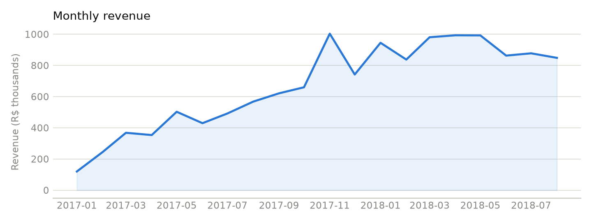
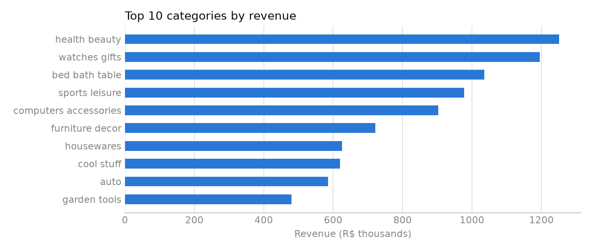
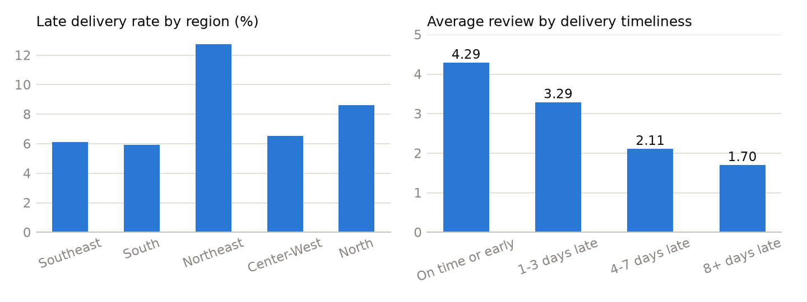

# E-commerce Business Performance & Revenue Analytics - Insights Report

## 1. Objective and business context
Management wants to understand revenue trends, product performance, regional differences, delivery performance and customer reviews, and to get recommendations for improvement.

## 2. Dataset and limitations
Brazilian E-Commerce Public Dataset by Olist ([Kaggle](https://www.kaggle.com/datasets/olistbr/brazilian-ecommerce)): about 99k orders (2016-2018) across 9 related tables (orders, items, payments, reviews, customers, products, sellers, category translation, geolocation).

- Scope: orders purchased Jan 2017 - Aug 2018 (20 complete months). 2016 and Sep-Oct 2018 are partial and excluded (349 orders).
- No cost data, so profitability cannot be measured; revenue is item price excluding freight.
- Reviews exist for about 99% of orders, but they are optional and may skew towards strong opinions.
- Delivery estimates are set by Olist; a late flag measures performance against the promise, not absolute speed.

## 3. Tools and methodology
Python (pandas) for profiling and cleaning; SQL (DuckDB, PostgreSQL-compatible) for joins and metrics; Excel for data-quality checks and validation; an HTML dashboard and a Power BI build guide for visualisation.
Headline numbers were validated three ways: SQL vs an independent pandas calculation, sums by month/category/state vs the total, and items + freight vs payments (difference 0.018%).

| KPI | Value |
|---|---|
| Revenue | R$13,449,529.68 |
| Distinct orders | 97,905 |
| Average order value | R$137.37 |
| Distinct customers | 94,703 |
| Average review score | 4.12 / 5 |
| Delivered late | 6.79% |
| Average delivery time | 12.5 days |

## 4. Key findings

**1. Revenue more than doubled year on year, but has plateaued in 2018.**

Revenue for Jan-Aug 2018 was R$7.34M, up 138% on the same months of 2017 (R$3.08M). Growth came from order volume, not basket size: orders rose from 22,562 to 53,530. The single best month was November 2017 (R$1.00M, the Black Friday month), and every 2018 month sat between R$0.84M and R$0.99M, so growth has levelled off.

**2. A few categories carry the business, and some earn far more per order.**

The top 10 of 74 categories generate 62% of revenue. Watches & gifts earns 8.9% of revenue from 5.7% of orders (AOV R$213 vs R$137 overall). Categories whose revenue share is at least 1.5x their order share: musical instruments, small appliances, office furniture, watches gifts. Bed, bath & table is the opposite: the most orders (9.6%) at a lower AOV of R$110.

**3. Sales are concentrated in the Southeast; the North and Northeast spend more per order but wait longer.**

The Southeast produces 65.4% of revenue, and Sao Paulo state alone 38.3%. Orders from the North and Northeast are larger (AOV R$182 and R$165 vs R$131 in the Southeast) but take 22 and 20 days to arrive, against 11 days.

**4. Late deliveries are uncommon overall but concentrated in the Northeast.**

6.8% of delivered orders arrived after the estimated date. The Northeast's late rate is 12.8%, about double the Southeast's 6.1%. Worst states with 300+ delivered orders: AL 21.5%, MA 17.5%, SE 15.4%.

**5. Late deliveries are strongly associated with poor reviews.**

Orders delivered on time average 4.29 stars; orders 8+ days late average 1.70. The share of 1-2 star reviews rises from 9% to 79%. This is an association, not proof of cause, but the gradient is steep and consistent across every delay band.

**6. Almost every customer buys only once.**

97.0% of customers placed a single order in the 20 months, and repeat customers produced only 5.6% of revenue. Growth so far has depended entirely on acquiring new buyers.

## 5. Recommendations

1. Fix fulfilment in the Northeast first. Audit carriers and seller dispatch times for AL, MA, SE and CE, and set more realistic delivery estimates there. Late orders are where 1-2 star reviews concentrate (finding 5).
2. Protect and grow high-value categories. Give watches & gifts, small appliances, musical instruments and office furniture more marketing space and seller recruitment; each order there is worth about 1.5-2x the average (finding 2).
3. Build a retention programme. With about 97% one-time buyers, a post-delivery email, a second-order voucher and category-based recommendations are cheap tests with large upside (finding 6).
4. Plan capacity for Black Friday. November 2017 was the peak month; logistics and customer service need to scale before Q4 so that the volume spike does not create a delay spike (findings 1 and 5).
5. Grow outside the Southeast carefully. North and Northeast buyers spend more per order, but long delivery times put reviews at risk. Regional fulfilment partners should come before regional marketing spend (findings 3 and 4).

## 6. Additional data that would improve the analysis

- Product cost and marketplace commission, to measure margin and true profitability.
- Marketing spend and traffic source, to calculate CAC and ROAS.
- Carrier and warehouse identifiers, to attribute delays to a specific logistics partner.
- Data after August 2018, to confirm whether the 2018 plateau continued.
