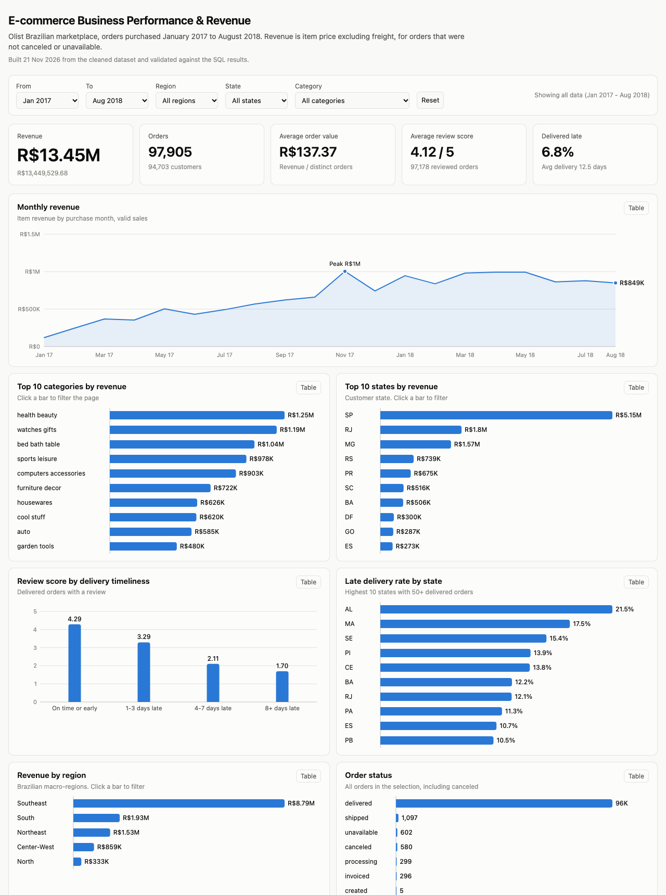

# E-commerce Business Performance & Revenue Analytics

**Tools:** Excel · SQL (DuckDB / PostgreSQL) · Power BI · Python · GitHub



## Business problem

I am a Business Analyst at an e-commerce marketplace. Management wants to understand
revenue trends, product performance, regional differences, delivery performance and
customer reviews, and wants recommendations for improvement.

| # | Question | Answer (Jan 2017 – Aug 2018) |
|---|---|---|
| 1 | What is the total sales revenue? | **R$13.45M** in item revenue from 97,905 orders (AOV R$137.37) |
| 2 | Which categories sell the most? | Health & beauty (R$1.25M), watches & gifts (R$1.19M), bed bath & table (R$1.04M) |
| 3 | Which regions contribute most? | Southeast 65.4% of revenue; São Paulo state alone 38.3% |
| 4 | How do sales change month by month? | Up 138% year on year (Jan–Aug), peak Nov 2017 (Black Friday), flat at about R$0.85–1.0M per month through 2018 |
| 5 | How often are orders late? | 6.8% of delivered orders; 12.8% in the Northeast, 21.5% in Alagoas |
| 6 | Do delays hurt reviews? | Yes, strongly associated: 4.29 stars on time vs 1.70 when 8+ days late |

## Dataset

[Brazilian E-Commerce Public Dataset by Olist](https://www.kaggle.com/datasets/olistbr/brazilian-ecommerce)
(Kaggle, licence CC BY-NC-SA 4.0). 9 CSV tables, about 99k orders placed from 2016 to 2018.

| Table | Rows | Grain |
|---|---:|---|
| orders | 99,441 | one row per order |
| order_items | 112,650 | one row per item in an order |
| order_payments | 103,886 | one row per payment record |
| order_reviews | 99,224 | one row per review (547 orders have 2+) |
| customers | 99,441 | one row per `customer_id`; the person is `customer_unique_id` |
| products | 32,951 | one row per product |
| sellers | 3,095 | one row per seller |
| category_translation | 71 | Portuguese → English category names |
| geolocation | 1,000,163 | many rows per zip prefix (not used) |

**Limitations:** no product cost or marketing spend, so there is no profit, CAC or ROAS.
Reviews are optional. The "late" flag compares delivery with Olist's own estimate.
Raw files are not committed (licence and size). `run.sh` / `run.bat` downloads them, and a
1,000-order sample is committed in [`Dataset/sample/`](Dataset/sample/).

## Methodology

1. **Profile** every table (grain, primary key, duplicates, nulls), then
   [`Dataset/cleaned/data_quality_profile.csv`](Dataset/cleaned/data_quality_profile.csv).
2. **Clean** ([`scripts/02_clean_data.py`](scripts/02_clean_data.py), log in
   [`cleaning_log.csv`](Dataset/cleaned/cleaning_log.csv)):
   IDs and zip codes kept as text (leading zeros); 610 products with no category become `unknown`;
   2 untranslated categories translated manually; misspelled columns renamed; a region added from the state;
   free-text review comments dropped (multi-line text breaks CSV imports). Rows are flagged, not deleted.
3. **Scope**: the 20 complete months (Jan 2017 – Aug 2018). 2016 and Sep–Oct 2018 are partial (349 orders).
4. **SQL** ([`SQL-Queries/`](SQL-Queries/)): two views aggregate items and reviews to order level
   *before* joining, so one-to-many joins cannot inflate revenue. Fourteen numbered queries answer the questions
   using JOINs, GROUP BY, CASE WHEN, CTEs and window functions (RANK, LAG, SUM OVER).
5. **Validate**: SQL totals equal an independent pandas calculation, monthly, category and state totals add up
   to the overall total, and items + freight reconcile with payments (0.018% difference).
   See [`SQL-Queries/results/00_validation_checks.csv`](SQL-Queries/results/00_validation_checks.csv).
6. **Excel** ([`Excel-Analysis/ecommerce_analysis.xlsx`](Excel-Analysis/ecommerce_analysis.xlsx)): data-quality
   and cleaning sheets, validation sheets with live formulas, analysis tables with charts, and a sample sheet with SUMIFS/COUNTIFS.
7. **Dashboard**: interactive HTML version plus a Power BI build kit (see below).

### Metric definitions

| Metric | Definition |
|---|---|
| Revenue | SUM(order_items.price), freight excluded, orders not `canceled`/`unavailable` |
| Orders | Distinct valid orders with at least one item |
| Average order value | Revenue / Orders |
| Late delivery % | Delivered orders whose delivery date > estimated date, / delivered orders with a delivery date |
| Review score | Average score per order, then averaged |

## Key findings

1. **Strong growth, now plateauing.** Jan–Aug 2018 revenue R$7.34M, +138% on Jan–Aug 2017, driven by order
   volume (AOV flat at about R$137). Every 2018 month falls between R$0.84M and R$0.99M.
2. **High-value categories punch above their volume.** Watches & gifts makes 8.9% of revenue from 5.7% of orders
   (AOV R$213). Musical instruments, small appliances and office furniture also have revenue shares at least 1.5x their order shares.
3. **Revenue is concentrated in the Southeast** (65.4%). North and Northeast orders are larger (AOV R$182 / R$165 vs
   R$131) but take about twice as long to arrive (22 / 20 days vs 11).
4. **Late deliveries cluster in the Northeast**: 12.8% late vs 6.1% in the Southeast (AL 21.5%, MA 17.5%, SE 15.4%).
5. **Lateness is strongly associated with bad reviews**: 1–2 star share rises from 9% (on time) to 79% (8+ days late).
6. **97% of customers buy once**, so repeat buyers produce only 5.6% of revenue.

Full report: [`Insights/insights_report.pdf`](Insights/insights_report.pdf) ([Markdown version](Insights/insights_report.md)).

## Recommendations

1. Fix fulfilment in the Northeast first (carrier/seller audit, realistic delivery estimates for AL, MA, SE, CE).
2. Give more marketing space and seller recruitment to high-AOV categories (watches & gifts, small appliances, instruments, office furniture).
3. Launch a retention programme (post-delivery email, second-order voucher, recommendations).
4. Scale logistics and support before Black Friday so the volume spike doesn't become a delay spike.
5. Expand in the North/Northeast only alongside regional fulfilment partners.

## Dashboard

- **[`PowerBI-Dashboard/dashboard.html`](PowerBI-Dashboard/dashboard.html)**: interactive dashboard that works offline in any
  browser on Mac or Windows. KPI cards, monthly revenue line, top categories, top states, regions, late-delivery
  rate by state, review score by delivery timeliness, and order status. Slicers: date range, region,
  state, category. Clicking a bar filters the page, and every chart has a Table view.
- **Power BI**: [`POWERBI_BUILD_GUIDE.md`](PowerBI-Dashboard/POWERBI_BUILD_GUIDE.md) with step-by-step instructions,
  [`measures.dax`](PowerBI-Dashboard/measures.dax), [`theme.json`](PowerBI-Dashboard/theme.json) and model tables
  generated into `PowerBI-Dashboard/model/`. Power BI Desktop is Windows-only (Mac: use a Windows VM).

## How to reproduce

Requires **Python 3.10+** ([python.org](https://www.python.org/downloads/); on Windows tick *Add python.exe to PATH*).
The first run downloads about 45 MB from Kaggle (no account needed) and takes under a minute.

**macOS / Linux** (Terminal):
```bash
cd Ecommerce-Business-Analytics
./run.sh                 # everything
./run.sh --from 3        # re-run SQL, Excel, dashboard and report only
open PowerBI-Dashboard/dashboard.html
```

**Windows** (Command Prompt, or double-click `run.bat`):
```bat
cd Ecommerce-Business-Analytics
run.bat
start PowerBI-Dashboard\dashboard.html
```
PowerShell users can run `.\run.ps1` instead.

If the automatic download fails, download the zip from Kaggle, extract the CSVs into `Dataset/raw/`, and run again.

**Run the SQL yourself:** the database is `Dataset/ecommerce.duckdb`. Open it in [DBeaver](https://dbeaver.io/)
(free, Mac and Windows) or the `duckdb` CLI and run any file in `SQL-Queries/` after `01_create_views.sql`.
For PostgreSQL, follow the header of [`SQL-Queries/00_postgres_setup.sql`](SQL-Queries/00_postgres_setup.sql). The queries
use PostgreSQL-compatible syntax.

### Project structure
```
Ecommerce-Business-Analytics/
├── Dataset/            raw/ (downloaded), cleaned/, sample/ (committed), ecommerce.duckdb
├── Excel-Analysis/     ecommerce_analysis.xlsx
├── SQL-Queries/        00_postgres_setup.sql, 01_create_views.sql, 02-14 analysis queries, results/
├── PowerBI-Dashboard/  dashboard.html, POWERBI_BUILD_GUIDE.md, measures.dax, theme.json, model/, screenshots/
├── Insights/           insights_report.pdf / .md, charts/
├── scripts/            01_download … 06_build_report, run_pipeline.py, dashboard/
├── run.sh  run.bat  run.ps1
└── INTERVIEW_NOTES.md
```
